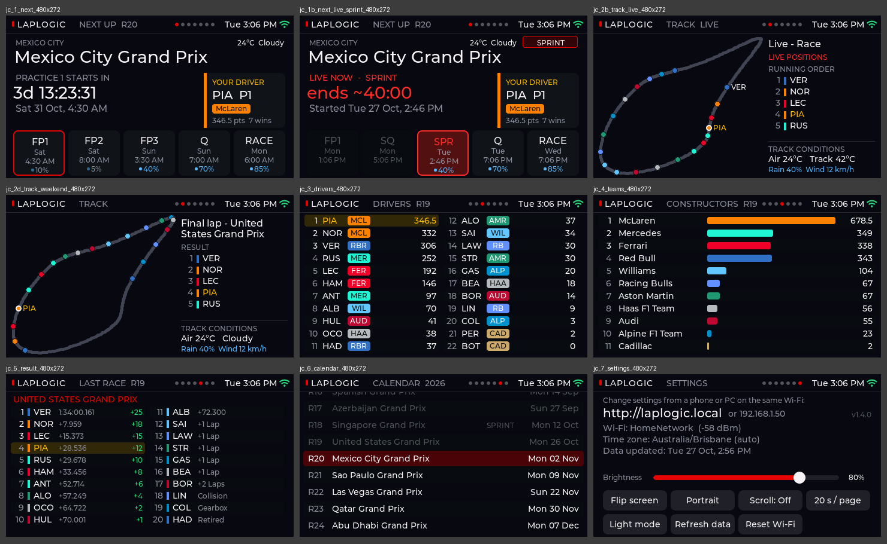

# LapLogic

An F1 desk display for two cheap ESP32 touchscreens. Countdowns to every session in your own
time zone, standings, results, the weather at the circuit, a live track map and race control
flags. Install it from your browser in a couple of minutes; no app or account needed.

## Boards

| Board | Screen | Notes |
|---|---|---|
| **Guition JC4827W543C** (ESP32-S3) | 4.3" 480×272, capacitive touch | Everything, including the live track map |
| **ESP32-2432S028R "Cheap Yellow Display"** (ESP32) | 2.8" 320×240, resistive touch | No track map; adds a rear race light, auto-dim and your own team logos from the SD card |

## Features

- **Next Up:** a live countdown to the next session, with the whole weekend's times in your local time
- **Drivers, Constructors, Last Race and Calendar,** with your favourite driver highlighted
- **Weather at the circuit,** plus the chance of rain for each session
- **Track map** (4.3"): each race's final lap replayed, or cars moving live with an
  [OpenF1](https://openf1.org) sponsor login, plus safety car and flag alerts
- **Rear race light** (CYD): blue for practice, purple for qualifying, green for the race
- Landscape or portrait, dark or light mode, brightness and auto-dim
- Settings in your browser at **laplogic.local**
- **Updates over Wi-Fi:** it tells you when a new version is out and installs it when you say so

## Install

1. Download **`LapLogic-Flasher.html`** from the [latest release](https://github.com/pulsesys-dev/LapLogic/releases/latest).
2. Open it in **Chrome or Edge**, choose your board, plug it in with a USB data cable and click
   **Connect & install**.
3. Enter your Wi-Fi details on the same page, then choose your favourite driver and time zone.

That's it. If the board won't connect, hold **BOOT** while you click Connect & install, and let go
when you see *Erasing* or *Installing*. Full steps,
including the first-time setup on the screen, are in [docs/install.md](docs/install.md).

## Documentation

| | |
|---|---|
| [Installing](docs/install.md) | Browser install, Wi-Fi setup, touch calibration, other flashing tools |
| [Using LapLogic](docs/using.md) | Pages, settings, track map, race light, team logos, weather, update speeds |
| [Updates over Wi-Fi](docs/updates.md) | How updates work, and how to publish a release |
| [Troubleshooting](docs/troubleshooting.md) | Common problems and fixes |
| [Building it yourself](docs/building.md) | Arduino IDE, PlatformIO, customising, how the code fits together |
| [Changelog](CHANGELOG.md) | What changed in each version |

## Data

Race data comes from the free [Jolpica F1 API](https://github.com/jolpica/jolpica-f1), the track map
from [OpenF1](https://openf1.org) and the weather from [Open-Meteo](https://open-meteo.com). None of
them need an account. LapLogic is not affiliated with Formula 1.

## Licence

MIT. See [LICENSE](LICENSE). The flasher page bundles esptool-js (Apache-2.0), pako and atob-lite
(MIT); see `tools/THIRD_PARTY_LICENSES.txt`.
